<div align="center">

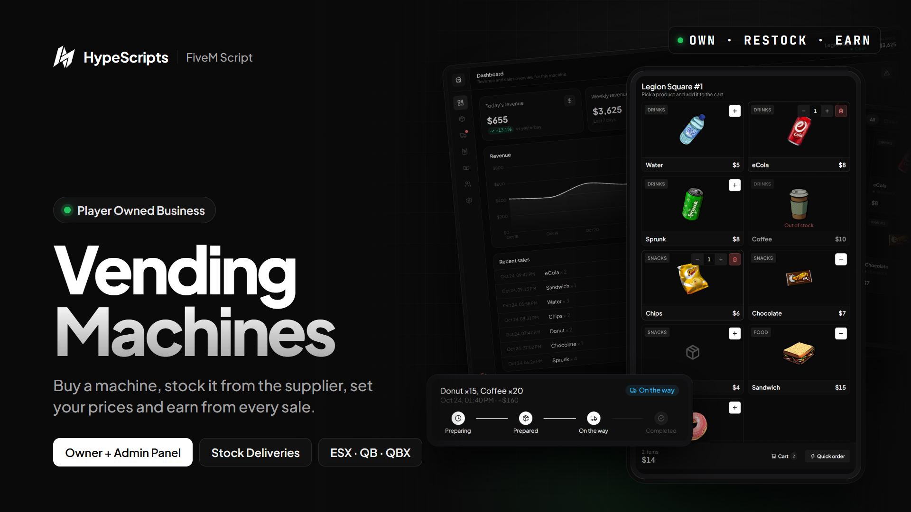

# hype-vendingmachine

**Player-owned vending machines with restock deliveries, staff and an admin panel**

Hype Vending Machine adds player-owned vending machines to FiveM. Owners buy machines, set prices, hire staff and earn from every sale, while stock is ordered from a supplier and delivered by hand with a cart. Admins place and manage every machine from an in-game panel.


[Features](#features) · [Screenshots](#screenshots) · [Installation](#installation) · [Configuration](#configuration) · [Usage](#usage) · [Admin panel](#admin-panel) · [Credits](#credits)

</div>

---

## Features

### For customers
- **Shop menu** with product images, categories, search and a cart.
- **Cash or bank** payment, with both balances shown. Owners choose which methods a machine accepts.
- **Glass machines** (optional, see [Glass machines](#glass-machines)) show the shop on their own touchscreen, and a robotic arm carries each item to the tray.

### For owners
- **Buy machines** that are for sale, up to a per-player limit.
- **Dashboard** with today's and weekly revenue, a 7-day chart, top products and recent sales.
- **Products**: set the price of every product, see stock, units sold and every purchase.
- **Restock** from the supplier with the machine balance: wholesale prices, "fill to capacity" and order tracking from preparing to completed.
- **Deliveries by hand**: pick the order up with a cart, move the boxes into any vehicle's trunk and put them into the machine.
- **Auto restock** when a product hits the low stock threshold, plus low stock and sale notifications.
- **Cash**: withdraw and deposit money, with a full history.
- **Opening hours** by in-game time, or a simple open / closed switch.
- **Transfer** the machine to another player or sell it back for a refund.

### Staff
- Hire nearby players as **Employee**, **Supervisor**, **Manager** or with custom permissions.
- **13 permissions**, from viewing stats to ordering stock, withdrawing money and managing staff.
- Staff can never sell or transfer a machine.

### For admins
- **Overview**: revenue, items sold, owners, top machines and machines that need attention.
- **Machine list with a map**: teleport, enable / disable, reset the balance, delete.
- **Placement tool** to create and move machines in game (move, rotate, snap to ground).
- **Export / import** machines as JSON to move them to another server.
- **Global settings** from the panel: wholesale multiplier, sales tax, machines per player, delivery time and defaults.
- **Discord webhook** logs for machine purchases and admin actions.

### Security
- Prices, stock, capacity, balances, distances and permissions are all checked on the server.
- Items that don't fit in the inventory are refunded.
- **10 locales**: English, Turkish, German, Spanish, French, Portuguese, Arabic, Chinese, Hindi and Bengali.

## Screenshots

<table>
  <tr>
    <td width="50%">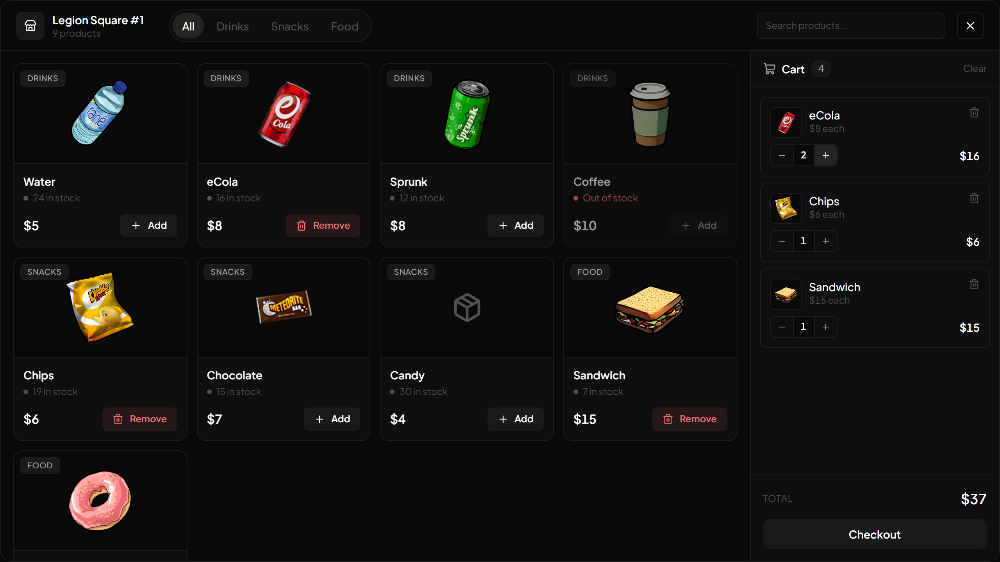</td>
    <td width="50%">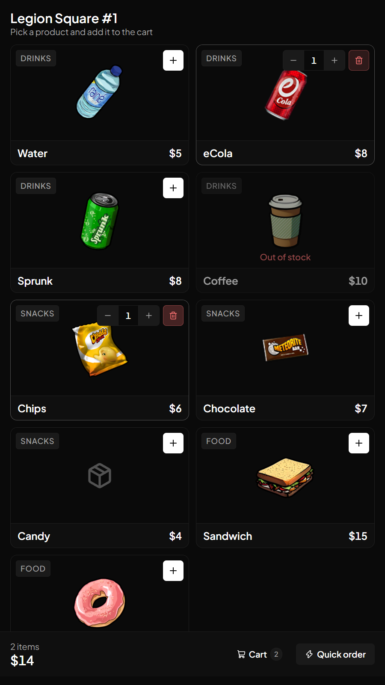</td>
  </tr>
  <tr>
    <td align="center"><sub>Shop menu with cart</sub></td>
    <td align="center"><sub>Touchscreen on a glass machine</sub></td>
  </tr>
  <tr>
    <td>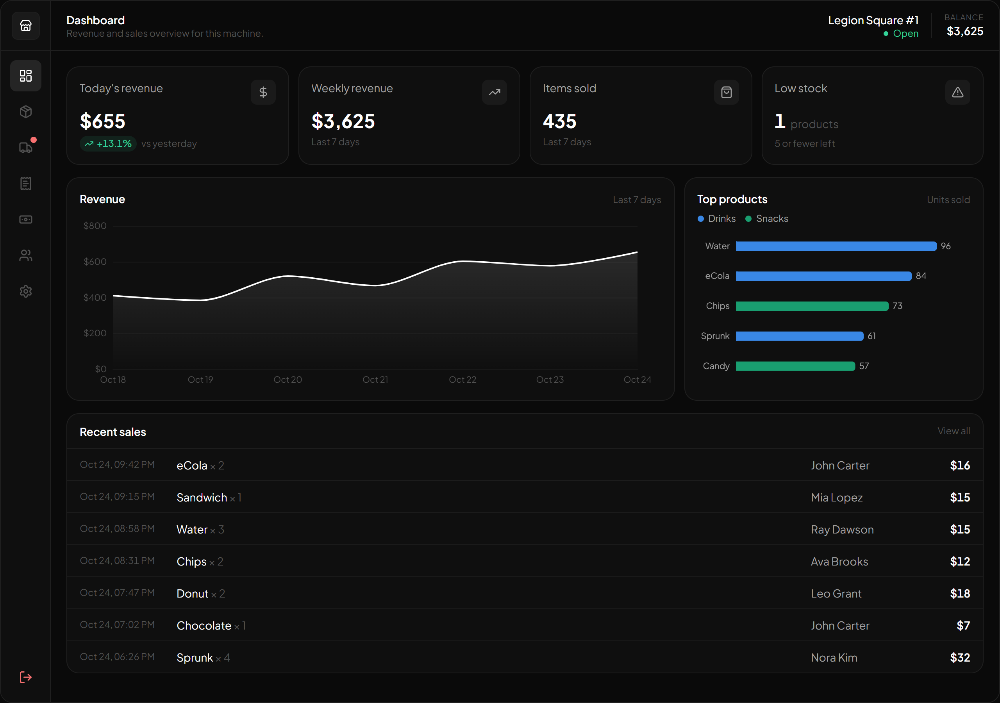</td>
    <td>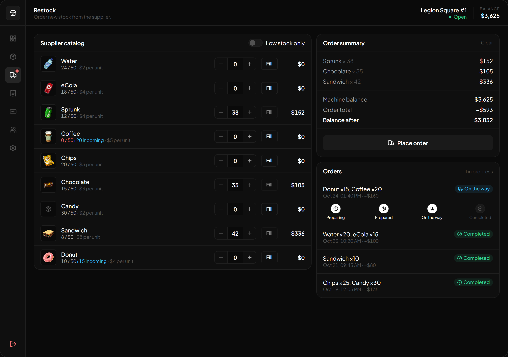</td>
  </tr>
  <tr>
    <td align="center"><sub>Owner dashboard</sub></td>
    <td align="center"><sub>Ordering stock from the supplier</sub></td>
  </tr>
  <tr>
    <td>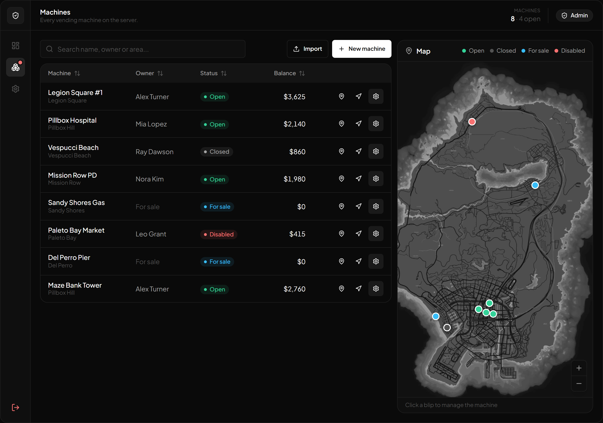</td>
    <td>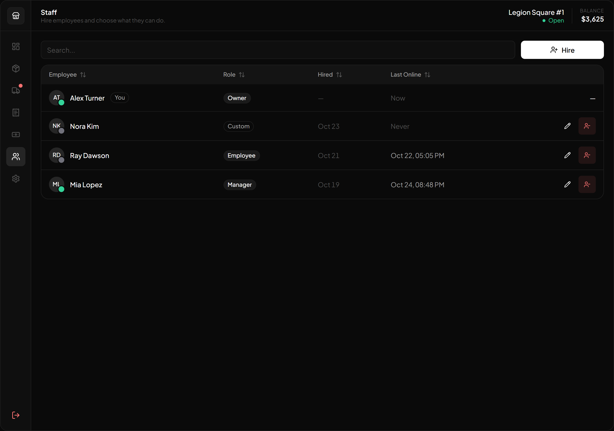</td>
  </tr>
  <tr>
    <td align="center"><sub>Admin machine list with map</sub></td>
    <td align="center"><sub>Staff and permissions</sub></td>
  </tr>
</table>

<details>
<summary><b>More screenshots</b></summary>
<br>

<table>
  <tr>
    <td width="50%">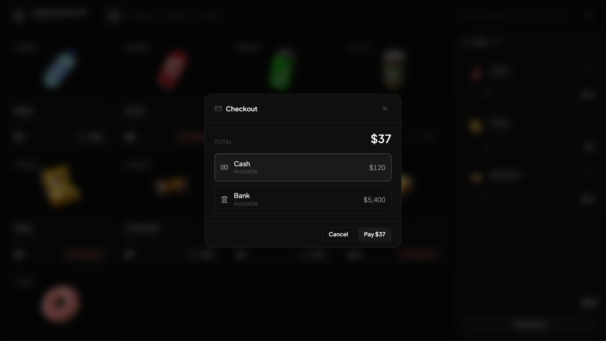</td>
    <td width="50%">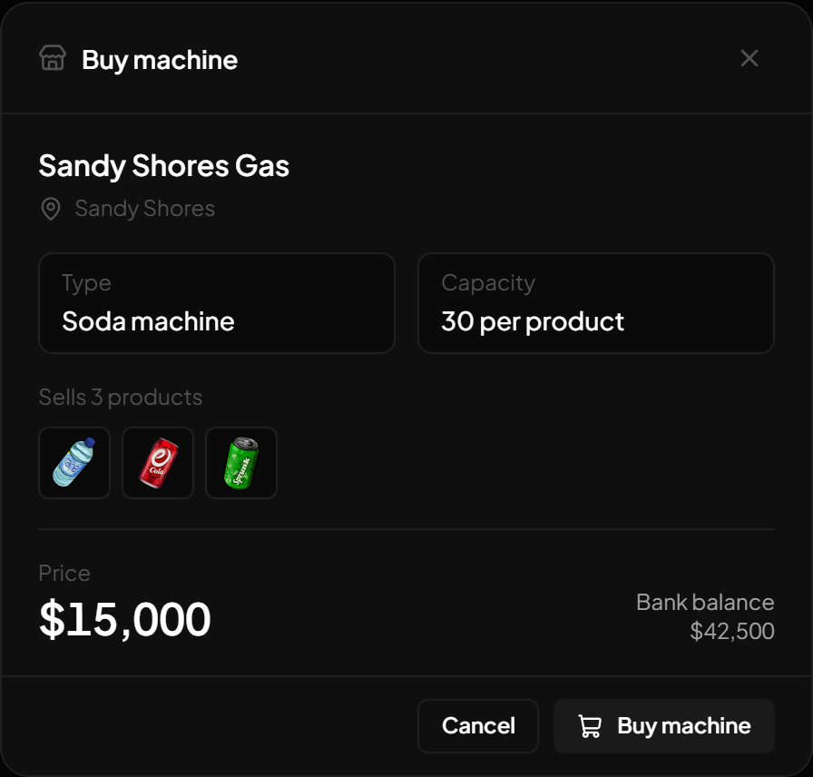</td>
  </tr>
  <tr>
    <td align="center"><sub>Checkout, cash or bank</sub></td>
    <td align="center"><sub>Buying a machine</sub></td>
  </tr>
  <tr>
    <td>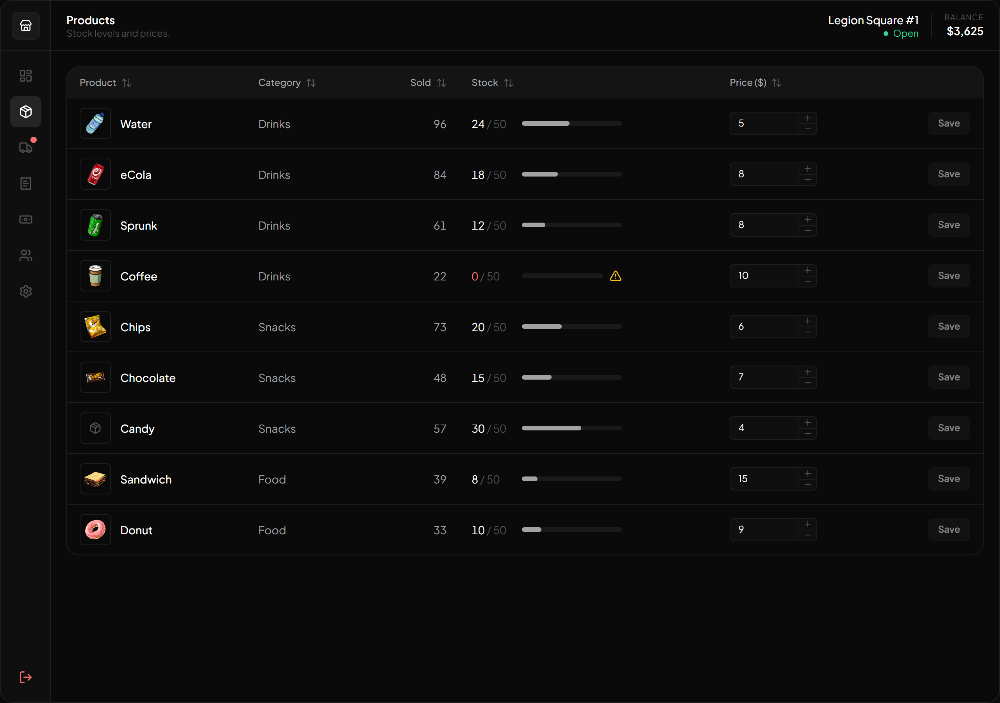</td>
    <td>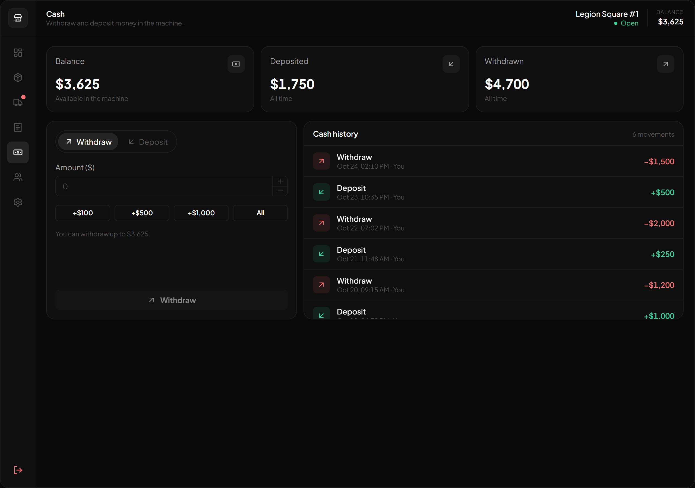</td>
  </tr>
  <tr>
    <td align="center"><sub>Products, prices and stock</sub></td>
    <td align="center"><sub>Cash, withdraw and deposit</sub></td>
  </tr>
  <tr>
    <td>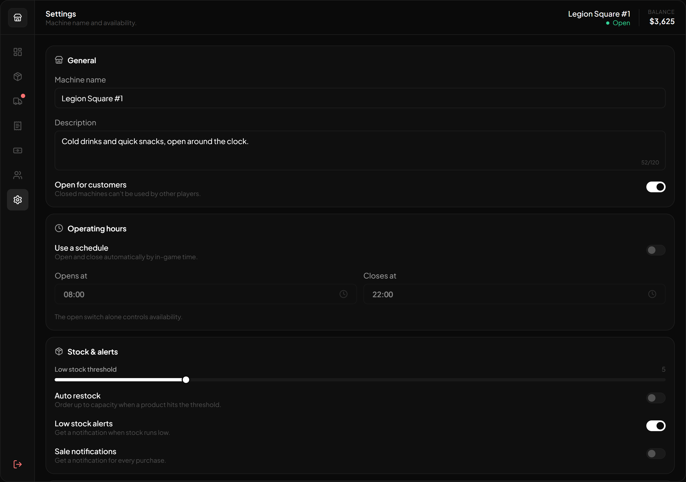</td>
    <td>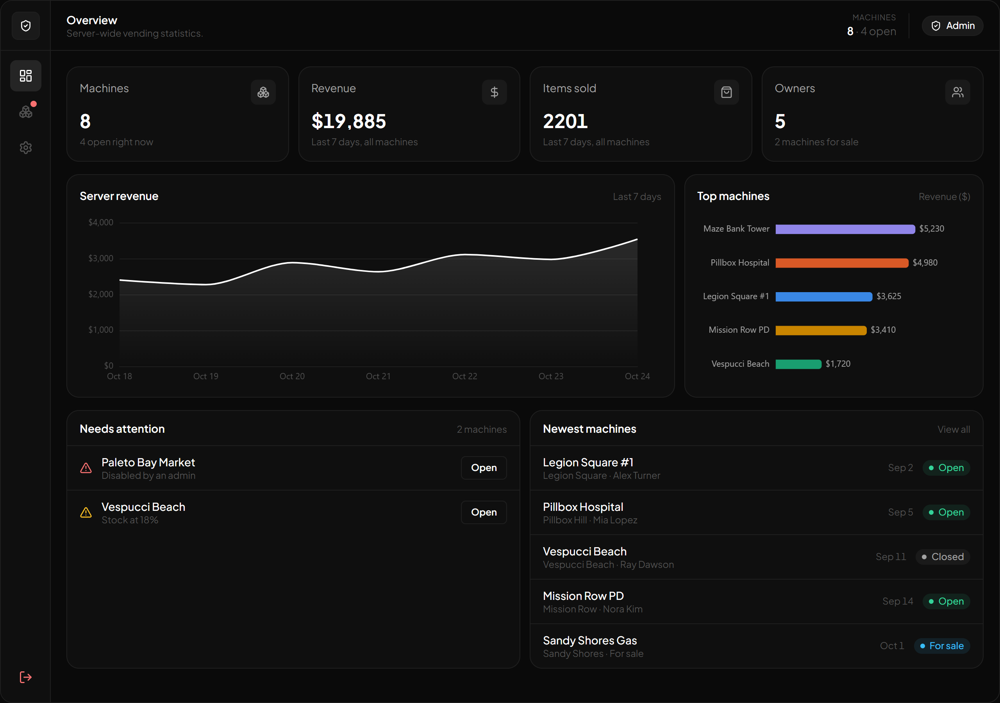</td>
  </tr>
  <tr>
    <td align="center"><sub>Machine settings</sub></td>
    <td align="center"><sub>Admin overview</sub></td>
  </tr>
  <tr>
    <td>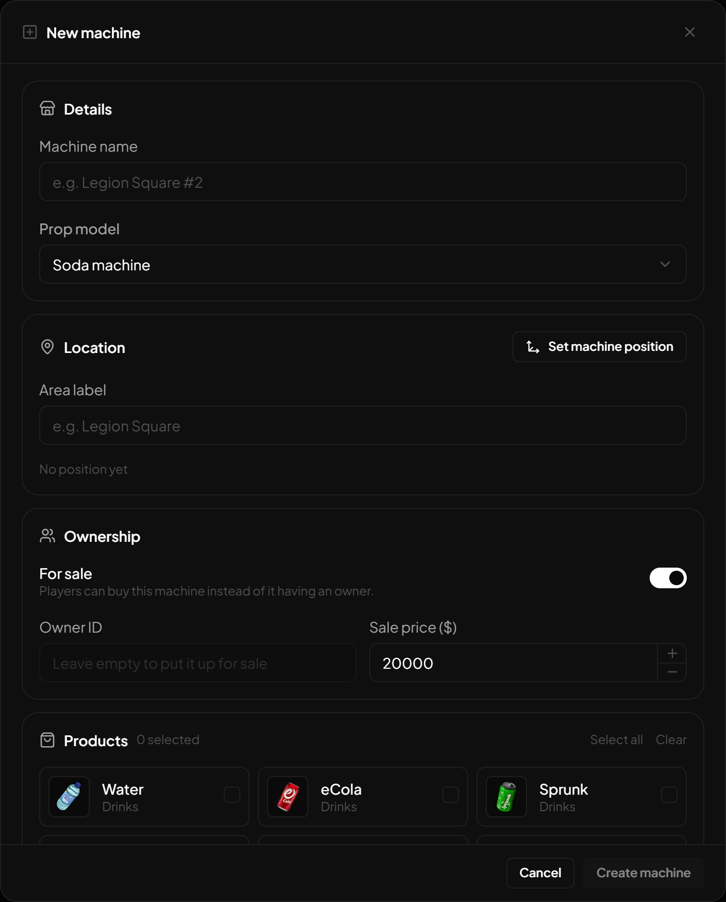</td>
    <td>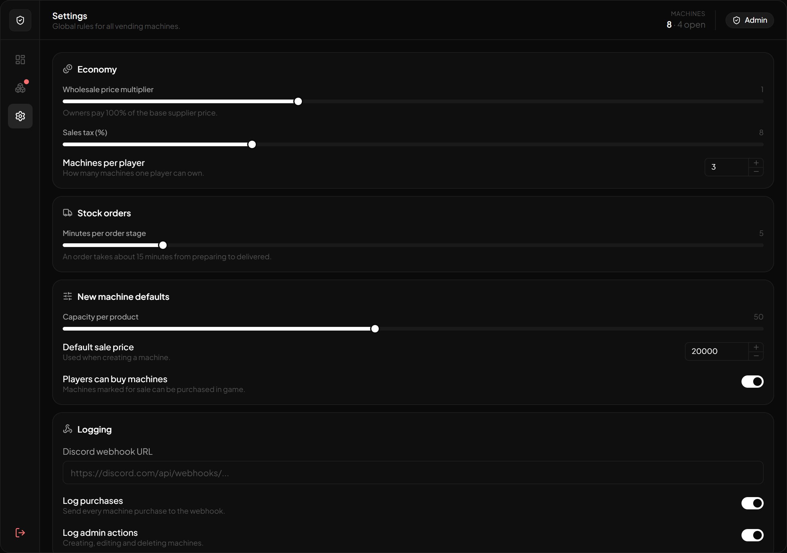</td>
  </tr>
  <tr>
    <td align="center"><sub>Creating a machine</sub></td>
    <td align="center"><sub>Admin settings</sub></td>
  </tr>
</table>

</details>

## Requirements

| Resource | Link / notes |
| --- | --- |
| hype-core | Included with the purchase. Bridges the framework, inventory, target, notify and text UI |
| ox_lib | https://github.com/overextended/ox_lib/releases/latest |
| oxmysql | https://github.com/overextended/oxmysql/releases/latest |
| Framework | `qbx_core`, `qb-core` or `es_extended` |
| Target | `ox_target` or `qb-target` (optional, falls back to a key prompt) |
| Glass machines | `olentrix_vending` (optional) |
| Database | MySQL 5.7+ or MariaDB 10.2+ (JSON columns) |

## Installation

1. Put the folder in `resources`. It has to be named `hype-vendingmachine`.
2. Start it **after** its dependencies in `server.cfg`:

   ```cfg
   ensure ox_lib
   ensure oxmysql
   ensure qbx_core          # or qb-core / es_extended
   ensure ox_target         # optional: ox_target or qb-target
   ensure hype-core
   ensure olentrix_vending  # optional, glass machines
   ensure hype-vendingmachine

   setr ox:locale "en"
   ```

3. **Database.** With `AutoRunSQL = true` (default) the tables are created on start. If that fails, or you turned it off, run `INSTALL/insert-me.sql` once. It is safe to run again. It creates:

   | Table | Contents |
   | --- | --- |
   | `hype_vending_machines` | Placed machines: position, model, owner, price, capacity, status, balance and owner settings |
   | `hype_vending_products` | Each machine's products with the owner's price, stock and units sold |
   | `hype_vending_transactions` | Every purchase. Revenue and sales charts are built from it |
   | `hype_vending_cash` | Deposits, withdrawals and stock order payments |
   | `hype_vending_orders` / `hype_vending_order_items` | Supplier orders and their lines |
   | `hype_vending_staff` | Employees and their permissions |
   | `hype_vending_settings` | Values saved in the admin panel's Settings page |

4. **Items.** Every product in `Config.Products` must exist as an inventory item with the same name (`id`). Ready-made snippets for ox_inventory and qb-inventory are in `INSTALL/items.md`. Copy `INSTALL/item-images` into your inventory's image folder.
5. **Props.** Everything in `stream/` is streamed automatically, including the `hype_cargo_box` cart (its `.ytyp` is loaded by `fxmanifest.lua`).
6. Set products, machine models and pickup points in `config/config.lua`, restart, then create your machines in game with `/vendingmenu`.

## Configuration

All options are in `config/config.lua` and commented in place. The most important ones:

| Key | Default | What it does |
| --- | --- | --- |
| `AutoRunSQL` | `true` | Runs `INSTALL/insert-me.sql` on start |
| `Currency` / `NumberAndDateFormat` | `USD` / `en-US` | How money and dates are shown in the UI, e.g. `EUR` with `de-DE` shows `1.250 €` |
| `Commands.AdminMenu` | `vendingmenu`, `group.admin` | Admin panel command and its permission |
| `Interaction.target` | `true` | Use ox_target / qb-target when one is running, TextUI otherwise |
| `Interaction.distance` / `maxDistance` / `spawnDistance` | `1.5` / `3.0` / `75.0` | Open range, max range the server accepts, prop spawn range |
| `Interaction.keys` | `E` / `G` | TextUI keys: shop and owner menu |
| `PurchaseAccount` / `CashAccount` | `bank` / `cash` | Account a machine is bought from, and the account owner deposits / withdrawals use |
| `DefaultSettings` | | Fallback for the admin panel's Settings page. Values saved in the panel win |
| `DefaultOwnerSettings` | | Opening hours, low stock threshold, auto restock, notifications and accepted payments for new machines |
| `Limits` | | Name lengths, max capacity and prices, machine spacing, order and transfer limits, history length |
| `SellRefund` | `50` | Percentage of the machine price paid back when an owner sells it |
| `Cargo` | | Cart and box models, pickup points, cancel distance, attach offsets and animations |
| `StaffPermissions` | 13 permissions | The permissions an owner can give to staff |
| `Machines` | 4 GTA models + 11 glass models | Models offered in the admin panel. `arm = true` marks glass machines |
| `Screen` | | Glass machine touchscreen: texture, size, camera and corner offsets |
| `Products` | 9 products | `id` (item name), name, category, starting `price`, supplier `wholesale` price, image and shelf model |

### Default settings

These are the fallbacks for the admin panel's Settings page:

| Key | Default | What it does |
| --- | --- | --- |
| `wholesaleMultiplier` | `1` | Multiplies every supplier price |
| `salesTax` | `8` | Percentage taken from every sale |
| `maxMachinesPerPlayer` | `3` | How many machines one player can own |
| `deliveryMinutes` | `5` | How long an order is `preparing` before it can be picked up |
| `defaultCapacity` / `defaultPrice` | `50` / `20000` | Pre-filled when creating a machine |
| `allowPlayerPurchase` | `true` | Players can buy machines that are for sale |
| `webhook` | `""` | Discord webhook. Empty turns webhook logs off |
| `logPurchases` / `logAdminActions` | `true` / `true` | What is sent to the webhook |

### How a delivery works

1. The owner orders stock from the **Restock** page. The wholesale price is paid from the machine balance.
2. The order is `preparing` for `deliveryMinutes`, then `prepared`.
3. At one of the `Cargo.spawns` points a cart appears with one box per product.
4. The player grabs the cart, loads the boxes into any vehicle's trunk and drives to the machine.
5. Each box put into the machine adds its stock. Going further than `Cargo.cancelDistance` from the pickup before every box is loaded cancels the order.

## Usage

| Action | Who | What it does |
| --- | --- | --- |
| Use a machine (target, or `E`) | Everyone | Opens the shop |
| Manage a machine (target, or `G`) | Owner and staff | Opens the owner panel |
| Look at a machine for sale | Everyone | Buy it |
| `/vendingmenu` | Admins | Opens the admin panel |
| `ESC` | | Back or close |

The command is registered with ox_lib as `restricted = "group.admin"` and every admin action is checked again on the server through hype-core. The default `server.cfg` admin setup is enough:

```cfg
add_ace group.admin command allow
add_principal identifier.fivem:123456 group.admin
```

## Owner panel

| Page | What you can do |
| --- | --- |
| **Dashboard** | Today's and weekly revenue, a 7-day chart, top products and recent sales |
| **Products** | Prices, stock and units sold for every product |
| **Restock** | Order stock from the supplier, fill to capacity, track orders |
| **Transactions** | Every purchase made at the machine |
| **Cash** | Machine balance, withdraw, deposit and the full history |
| **Staff** | Hire nearby players, pick a role or custom permissions, fire staff |
| **Settings** | Name, description, open / closed, opening hours, low stock alerts, auto restock, accepted payments, transfer and sell |

Staff only see the pages their permissions allow.

## Admin panel

Open it with `/vendingmenu`.

| Page | What you can do |
| --- | --- |
| **Overview** | Revenue, items sold, owners, top machines and machines that need attention |
| **Machines** | Every machine on a map and in a list: teleport, enable / disable, reset the balance, delete, open details |
| **New machine** | Name, model, price, capacity and position with the placement tool |
| **Settings** | The [default settings](#default-settings) above, saved to the database |

Machines can be exported as JSON and imported on another server (up to `Limits.maxImport` per import).

## Glass machines

With `olentrix_vending` running, the `arm = true` models in `Config.Machines` become glass machines. Their stock sits on the shelves behind the glass, the shop opens on the machine's own touchscreen instead of the menu, and a robotic arm carries each unit sold to the tray. The items reach the buyer's inventory once the arm drops them.

All olentrix models share one body, so one set of `Config.Screen` offsets fits all of them. Without olentrix_vending, just don't place `arm` models.

## Locales

In-game texts come from `locales/*.json` through ox_lib. Included: `en`, `tr`, `de`, `es`, `fr`, `pt`, `ar`, `zh`, `hi`, `bn`.

- **Choose a language** in `server.cfg`: `setr ox:locale "tr"`. Missing languages fall back to English.
- **Add a language:** copy `locales/en.json` to `locales/<code>.json`, translate the values and keep the keys and placeholders.

## Compatibility

Everything goes through hype-core, so the same bridges are used:

| Type | Supported |
| --- | --- |
| Framework | qbx_core, qb-core, es_extended |
| Target | ox_target, qb-target (optional, falls back to a key prompt) |
| Notifications | ox_lib, okokNotify, ps-ui |
| Text UI | ox_lib, okokTextUI, jg-textui, ps-ui, qb-core |
| Inventory | ox_inventory, qb-inventory, ps-inventory, codem-inventory, core_inventory, jpr-inventory, origen_inventory, tgiann-inventory |

Config, locale, shared and server files are open and can be edited, the rest is protected with Cfx.re Asset Escrow.

## Credits

Made by **HypeScripts**. For support, questions and updates, join the Discord.

| | |
| --- | --- |
| Discord | https://discord.gg/K5CufCxqUU |
| Discord username | `turtle8782` |

## License

See [LICENSE](LICENSE).

<div align="center">
<sub>Made by <b>HypeScripts</b></sub>
</div>
